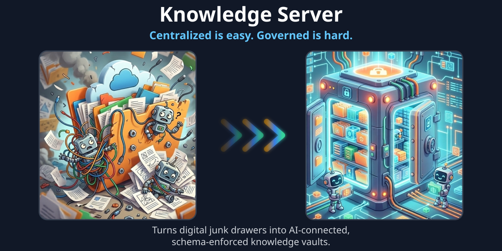

# Knowledge Server

**A centralized knowledge store shared by every AI assistant I use. It stays organized, stays current, and belongs to me.**

Most AI assistants ship with limited, disorganized knowledge bases, each walled off from the others. Mine share one source of truth. Claude, OpenClaw, and LibreChat read from and write to the same knowledge base every day, so whatever one learns, the others know. Any other harness I stand up or subscribe to can join them.

What makes it more than a shared folder is that **it governs itself**. Only well-formed notes get in. Outdated knowledge is retired from search without being lost. Any assistant, from any vendor, can plug in and pick up exactly where the last one left off.

## The problem: AI memory is a digital junk drawer

My project history was scattered across Claude, ChatGPT, coding assistants, and my own agents, each holding a different slice of my work. Picking up a project meant remembering which AI I'd last discussed it with.

The obvious fix is one shared folder. But give three AI assistants free rein over a folder and within a week you have duplicate notes, half-finished brainstorms posing as final decisions, and no way to tell what's still true.

I didn't just want my knowledge in one place. I wanted it to stay trustworthy.

## How it stays trustworthy

- **The rules are built in, not requested.** Asking an AI to "please keep things tidy" works until it doesn't. With the Knowledge Server every note must declare what it is, whether it's current, and where it came from. That's the only kind of note the system accepts, and when an AI gets it wrong, the system tells it exactly what to fix.
- **It knows what's still true.** Ordinary AI search finds text that *sounds* related, including last month's abandoned plan. This search also knows which notes are current, so assistants answer from today's decisions, not yesterday's.
- **It finds things by meaning.** Ask "how do I restart the server?" and it finds the right procedure even if the word "restart" never appears.
- **Nothing changes without a preview.** Every edit can be shown as an exact before-and-after before anything is saved.
- **Nothing is ever lost.** Every change is recorded with who made it and when. Retired notes move to an archive, out of the way but always recoverable.
- **Owned, not rented.** The knowledge is plain text files on my own hardware, and search runs locally. When a better AI arrives, it plugs into the same memory on day one.

## In daily use

This isn't a demo. It has run continuously since July 2026 as the memory behind my everyday work:

- Claude (desktop, web, and Claude Code), LibreChat, and OpenClaw all connect to the Knowledge Server through the open [Model Context Protocol (MCP)](https://modelcontextprotocol.io).
- Each assistant's contributions are attributed to it, so I always know which AI wrote what.

A real session in Claude, start to finish:

*1. I ask a question. Claude searches the vault and opens the relevant note on its own.*

*2. Each search result carries its type and status, so Claude knows this note is current, not retired.*

*3. The answer comes from the shared memory, not from whatever this one chat happens to remember.*

## Under the hood

A lightweight Python service on a home server. Notes are Markdown files with structured metadata based on the Dublin Core standard, versioned in Git. Search uses an embedding model running locally and a SQLite index. The index is disposable: it can be rebuilt from the notes at any time, so the notes are the single source of truth.

Assistants work through six purpose-built tools and never through raw file access:

- `vault_search` — Finds relevant knowledge by concept and meaning (semantic vector search), filtered to current knowledge by default.
- `vault_browse` — Lets an agent navigate folder hierarchies or read complete notes with structured context.
- `vault_write` — Creates a new document or completely overwrites an existing one, strictly validating frontmatter and schema compliance first.
- `vault_patch` — Performs targeted string replacements in existing notes without risk of rewriting or wiping valid content.
- `vault_archive` — Retires an outdated note to an archive directory and marks it superseded, preserving full Git history while removing it from active search.
- `vault_reindex` — Triggers an incremental or full rebuild of the local SQLite vector database directly from the Markdown source of truth.

**Stack:** Python · MCP (FastMCP) · SQLite · Ollama · Git

### Where to look in the code

| If you're curious about… | Start here |
|---|---|
| How the rules are enforced | [`ks/validator.py`](ks/validator.py) |
| How edits are previewed, saved, and versioned safely | [`ks/writer.py`](ks/writer.py) |
| How search filters out outdated knowledge | [`ks/search.py`](ks/search.py) |
| How assistants connect and what they're allowed to do | [`ks/server.py`](ks/server.py) |

Design decisions and tradeoffs in depth: **[docs/ARCHITECTURE.md](docs/ARCHITECTURE.md)**

## About

A personal project by **Ross Blanchard**.

*I still rent the AI. But I own my data, and it's clean.*

## License

MIT — see [LICENSE](LICENSE).
