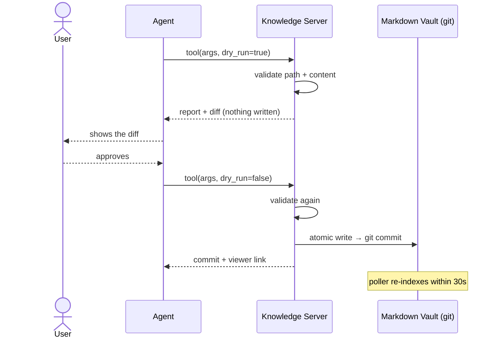

# Architecture

- **Document type:** Architecture and design rationale
- **Related:** [VAULT-SCHEMA.md](VAULT-SCHEMA.md) (the note contract), [DEPLOYMENT.md](DEPLOYMENT.md) (running it)

This document explains how the Knowledge Server works and, more importantly, why it is built this way. It is written for engineers evaluating the design.

---

## 1. The thesis

A shared AI memory fails for a predictable reason, and it isn't the model.

Bare retrieval-augmented generation (RAG) degrades as it grows. A superseded runbook is well-written, so it keeps ranking highly. An early decision and its later reversal sit side by side, and search returns whichever is more textually similar, not whichever is true. Drafts and near-duplicates pile up. Nothing records where a note came from. This is **context rot**, and a more capable model does not repair it, because the gap is in the system's structure, not the model's reasoning.

The design response is a distinction between two things often lumped together as "memory":

- **Recall** is retrieving material that resembles a query. A vector index provides it, and it really does work on meaning: "how do I restart the service" finds "service recovery procedure" with no shared keywords.
- **Comprehension**, as used here, is knowing the *status* of knowledge: which of two similar notes is current, which was retired, what kind of document each is, and where it came from.

Embeddings give recall only. A point in vector space carries no notion of authority or time. So the Knowledge Server adds a **governed layer** above the index: a small set of typed, validated metadata on every note, enforced at **write time**. The model still doesn't "understand" anything; the system is structured so that retrieval behaves as if it does. Retrieval quality becomes a property of the architecture, not of whichever model is plugged in.

---

## 2. Layered model

```
  Access layer      MCP tools over Streamable HTTP (FastMCP)
                    + OAuth 2.1 authorization server + web viewer
  ───────────────────────────────────────────────────────────
  Index layer       SQLite (vectors + metadata + notices),
                    refreshed by a 30s poller. DERIVED / REBUILDABLE.
  ───────────────────────────────────────────────────────────
  Storage layer     Markdown vault, git-versioned, Dublin Core
                    frontmatter. DURABLE SOURCE OF TRUTH.
```

The separation is load-bearing. The storage layer survives everything above it. The index is a cache that can be rebuilt from the notes at any time. The access layer is a swappable interface. Any layer above storage can be replaced without data loss, which is also why assistants, harnesses, and models can come and go while the knowledge stays.

**Design stance:** minimal moving parts, local-first, rebuildable. Embeddings are computed locally, similarity is computed in-process, and there is no external vector database or cloud dependency.

---

## 3. The governed layer

Every note carries a small YAML frontmatter block. The full field contract is in [VAULT-SCHEMA.md](VAULT-SCHEMA.md). The roles that matter architecturally:

- **A standard vocabulary.** Field names come from Dublin Core wherever a term applies (`title`, `type`, `subject`, `created`, `source`, `relation`). The vault speaks a language other tools already understand, and because the terms are RDF-compatible, notes can later be projected into JSON-LD or a knowledge graph with no field renaming. Local additions such as `status` are marked as extensions, so the standard and the custom are never confused.
- **Controlled vocabularies.** `type` (decision, runbook, note, glossary, reference, specification, journal) and `status` draw from small fixed sets. A field that permits anything classifies nothing.
- **Lifecycle (`status`).** The single most important field: `draft`, `active`, or `superseded`. Search excludes superseded and archived material by default. Retired notes are kept and remain searchable on explicit request, so the system can answer "what did we used to believe?" without polluting "what is true now?"
- **Provenance and attribution.** `source` and `relation` record where a note came from and what it depends on (a superseded note points to its replacement). `identifier` gives every note a permanent UUIDv7, and `creator` records which agent or human wrote it.

**Enforcement at write time.** A documented schema is an inconsistently followed schema. All write tools validate before anything touches disk, and every rejection returns a structured `{field, rule, message}` error so an agent can correct itself and retry. The only way to add knowledge is to add well-formed, classified, attributed knowledge.

---

## 4. Components

| Component | Module | Responsibility |
|---|---|---|
| MCP server | `ks/server.py` | Registers the tools and auth routes, enforces host/origin allow-lists, binds loopback only, starts the poller. |
| Embedder | `ks/embed.py` | Local Ollama, `mxbai-embed-large` (1024-dim), pinned resident. The model's instruction prefix is applied to queries only, never documents, as the model requires. |
| Indexer and search | `ks/indexer.py`, `ks/db.py`, `ks/search.py` | Heading-aware chunking, incremental by content hash; cosine ranking in-process with numpy; SQLite in WAL mode so reads never block on writes. |
| Poller | `ks/server.py` | Every 30s: incremental reindex, maintenance checks, expired-auth cleanup. Started once in `main()`, not in the per-session lifespan hook, so exactly one runs. Errors are logged and retried, never fatal. |
| Validator | `ks/validator.py` | Pure, I/O-free schema and path checks. Shared by the write tools, the notices check, and the vault's pre-commit hook, so every entry point applies the same rules. |
| Writer | `ks/writer.py` | Path resolution against the real vault root (defeats traversal and symlink escapes), dry-run diffs, atomic writes, one git commit per change, serialized by a lock. |
| Authorization | `ks/auth.py`, `ks/setpass.py` | Embedded OAuth 2.1 server (§7). |
| Notices | `ks/notices.py` | Maintenance notice store, checks, and surfacing (§6). |
| Web viewer | `ks/viewer.py` | Read-only browser view of the vault (§8). |
| Logging | `ks/logging_config.py` | Configured before anything else imports, so even a startup failure is logged. One JSONL audit line per tool call. |

---

## 5. The tools

Agents never touch files directly. They work through purpose-built MCP tools, named by what they act on: `vault_` for notes, `ks_` for the system itself.

| Tool | Kind | Behavior |
|---|---|---|
| `vault_search` | read | Semantic search with `type`/`status` filters; current knowledge only by default. Results flag notes with an open notice. |
| `vault_browse` | read | Lists notes with metadata, or returns one note in full. |
| `vault_write` | write | Validated create or overwrite. Returns a viewer link to the result. |
| `vault_patch` | write | Replaces a string that must match exactly once; zero or multiple matches fail closed rather than guess. Cannot change `identifier` or `creator`. |
| `vault_archive` | write | Moves a note to `archive/` with `git mv` and marks it superseded. History follows the note. |
| `vault_reindex` | index | Rebuilds the index on demand; `force=true` re-embeds everything. Shares a lock with the poller. |
| `ks_notices` | read | Lists maintenance notices by state, severity, or check. |
| `ks_notice_dismiss` | write | Defers a notice to a date, or exempts it permanently with a reason. |

### 5.1 How a change is made

`vault_write`, `vault_patch`, and `vault_archive` are three payloads over one shape: a dry run, human approval of the diff, then a real call that validates again before touching disk.



Two details matter. The validator runs twice, because what was previewed and what is about to be written are never assumed identical. And every commit records the originating client, so the audit trail is uniform across tools.

---

## 6. Maintenance notices

**The problem.** MCP gives a server no way to speak first; it only answers tool calls. So when something goes wrong outside the tools, such as a hand edit in a Markdown editor that breaks a note's frontmatter, nothing tells the owner until something else fails.

**The design.** The server checks the vault on every poll, using the same validator as the write tools. Anything that needs a human decision becomes a **notice**. The next time any connected agent calls any tool, the response carries an extra attention block listing what's due. The agent pauses, tells the user, and offers a fixed menu:

- **Fix:** propose a correction, dry run first. The notice closes on its own at the next poll once the check passes.
- **Defer:** hide it until a date (three days by default).
- **Exempt:** "this file is fine as it is." The decision and the user's reason are written to an exemptions note in the vault, under git, so it survives reindexing.
- **Leave it:** it comes back on schedule.

The agent never acts without the user's choice.

**Not nagging.** A warning surfaces at most once a day per client group, and a brand-new notice surfaces immediately. Deferring the same notice three times turns it into a one-line daily reminder rather than a full prompt.

**Client groups.** Surfacing is tracked per *bucket*: a server-side rule that recognizes a family of client registrations by name and exact callback address, and sets what that family may do (§7). Client IDs aren't used because they change every time a client re-registers.

**State.** Notices and deferrals live in the index database, since they are disposable derived state. Exemptions are durable owner decisions, so they live in the vault.

**Built to grow.** Note health is the first check. The same store, lifecycle, and tools are designed to take on system checks, such as a scheduled job that hasn't reported success in 26 hours, without reshaping anything.

---

## 7. Access control

- **OAuth 2.1 with PKCE and dynamic client registration.** Any MCP client can register itself, but authorization only completes after the owner enters a passphrase on the consent screen. That screen is the human gate on what connects.
- **Tokens.** Access tokens are short-lived stateless JWTs, verified by signature without a database read; the tradeoff is that a live access token can't be individually revoked within its one-hour lifetime. Refresh tokens are opaque, stored, and rotate on every use, which is where revocation applies.
- **Buckets.** A connected client that matches no bucket can read but not write. A bucket also limits which `creator` names its clients may sign notes with, so one assistant can't sign as another. Bucket definitions are deployment configuration and are not included in this repository.

---

## 8. Reading the vault without an agent

- **Web viewer.** A read-only, passphrase-protected web view served by the same process, reachable from anywhere the server is: a folder tree, search, rendered notes, and links between related notes. Write tools return a viewer link, so every change can be checked in a browser. Archived and superseded notes stay hidden unless asked for, matching search.
- **Any Markdown editor.** The vault is a plain git repository of Markdown, so it opens directly in Obsidian or any other editor. Hand edits are checked twice: a pre-commit hook runs the shared validator, and the notices check catches anything that lands another way.

---

## 9. Key decisions and tradeoffs

- **Enforce at write, not read.** Correctness checked only at retrieval was never guaranteed. The write is the chokepoint.
- **Loopback-only bind.** The process never faces the network; a tunnel or reverse proxy handles TLS and edge protection.
- **Poller over filesystem watch.** Simpler and dependency-free. An unchanged pass costs milliseconds, so up to 30 seconds of staleness is a cheap price.
- **In-process similarity, no vector database.** Right for this scale, and it removes an operational dependency. A scale choice, not a universal one.
- **Derived index.** Losing it means a rebuild, not data loss.
- **Preserve, don't delete.** Supersession is a status change and a move, never a deletion. History is an asset.
- **Server-generated notices only.** Attention blocks carry paths and server-written summaries, never note text, so a malicious filename or note body can't smuggle instructions to an agent.

---

## 10. Constraints and failure modes

- **Scale.** In-process ranking and a polling indexer suit hundreds to low thousands of notes. Beyond that, the index layer would be swapped for a dedicated vector store; the layered model allows this without touching storage or access.
- **Embedder outage.** If Ollama is down, search and indexing degrade and retry. Writes still succeed, and the index catches up when the embedder returns.
- **Single writer.** The write lock assumes one process. Horizontal scaling would need a different concurrency model; out of scope by design.
- **Model changes.** Vectors aren't comparable across embedding models, so a swap requires a full re-embed and a re-check of the query-prefix asymmetry.
- **Silent when idle.** Notices only surface when an agent calls a tool. Acceptable, since nothing consumes the vault while it's idle. The server also can't report its own outage, so agents are instructed to say "the Knowledge Server is unreachable" rather than quietly answer from memory.

---

## 11. Direction

The Dublin Core metadata was chosen so a formal **knowledge graph** is an extension, not a migration: each note is a candidate node, its `type` a node type, its `relation` list a set of edges. The likely shape is an embedded graph store (such as Kuzu) using `schema.org` vocabulary where it fits. This is held until there's a concrete need for multi-hop queries across entity types. See [VAULT-SCHEMA.md §4](VAULT-SCHEMA.md#4-provisional-knowledge-graph-extension).
